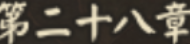
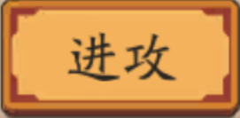
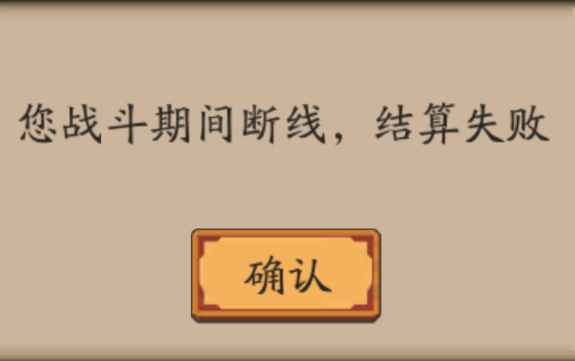
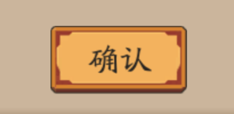
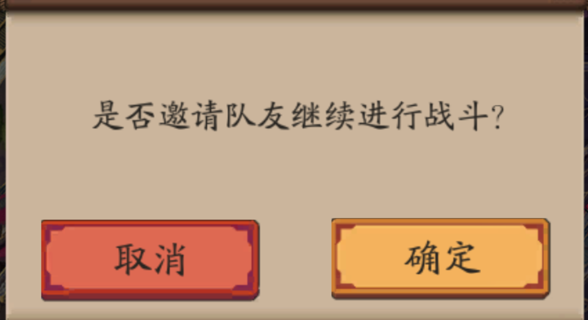
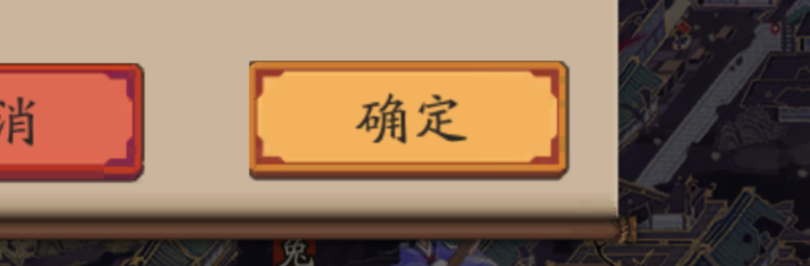

# yys_bot - 阴阳师模拟器自动化脚本 (fast3.1)

基于图像识别的《阴阳师》桌面模拟器自动化脚本，支持多副本挂机、结界突破、断线重连与死循环自动恢复。

## ✨ 版本特性 (fast3.1)

| 版本 | 特性 |
|------|------|
| **fast1.x** | 多线程GUI架构（主线程UI + 子线程业务） |
| **fast2.x** | 图像识别引擎（协战检测、超时保护、精确点击）；连续6次拖拽自动状态恢复 |
| **fast3.0** | debug_screenshots 10次自动关机保护；结界突破断线自动重连 |
| **fast3.1** | PyAutoGUI fail-safe 安全修复（角落光标保护、安全点击封装） |

---

## 📋 目录

- [环境要求](#环境要求)
- [安装与配置](#安装与配置)
- [图片模板说明](#图片模板说明)
- [选项1：K28+TP 详细教程](#选项1k28tp-详细教程)
  - [什么是 K28+TP](#什么是-k28tp)
  - [启动流程](#启动流程)
  - [K28 探索循环](#k28-探索循环)
  - [结界突破 (TP)](#结界突破-tp)
  - [自动状态恢复](#自动状态恢复)
  - [断线重连](#断线重连)
- [调试与故障排查](#调试与故障排查)
- [其他选项](#其他选项)

---

## 环境要求

| 依赖 | 说明 |
|------|------|
| **Python** | 3.7+ |
| **模拟器** | 阴阳师桌面版 或 安卓模拟器（如 MuMu/雷电） |
| **操作系统** | Windows |

### Python 依赖安装

```bash
pip install opencv-python numpy pyautogui pygetwindow pynput
```

> `tkinter` 通常随 Python 一起安装，无需额外安装。

---

## 安装与配置

1. **克隆仓库**
   ```bash
   git clone https://github.com/xiaohei-hash/yys_bot.git
   cd yys_bot
   ```

2. **打开阴阳师桌面版**，确保窗口可见（不要最小化）。

3. **运行脚本**
   ```bash
   python fast3.1.py
   ```

4. 在弹出的 GUI 窗口中输入选项和参数（详见下方各选项说明）。

---

## 图片模板说明

脚本通过 `images/` 目录下的模板图片进行图像识别匹配。以下是所有图片及其用途：

### 🔑 核心导航图片

| 图片 | 界面位置 | 用途 |
|------|----------|------|
|  `i_tansuo.png` | 庭院主界面 | **探索入口** - 点击进入探索章节列表 |
|  `i_28.png` | 探索章节列表 | **K28主页** - 第28章探索入口 |
|  `i_boss.png` | 章节地图 | **BOSS战斗** - 点击进入BOSS战 |
|  `i_zhandou.png` | 章节地图 | **普通战斗** - 点击进入小怪战斗 |

### ⚔️ 战斗与奖励图片

| 图片 | 界面位置 | 用途 |
|------|----------|------|
|  `i_end.png` | 战斗结算 | **战斗结束** - 战斗胜利后的结算界面，点击关闭 |
|  `i_paper.png` | 战斗结算 | **纸人奖励** - 点击领取纸人撒出的奖励 |
|  `i_treasure.png` | 章节地图 | **宝藏** - 地图上出现的宝箱，点击进入奖励战斗 |

### 🔄 导航与返回图片

| 图片 | 界面位置 | 用途 |
|------|----------|------|
|  `fanhui.png` | 通用 | **返回按钮** - 点击返回上一级菜单 |
|  `fanhui1.png` | 通用 | **返回按钮1** - 备用返回按钮 |
|  `fanhui2.png` | 通用 | **返回按钮2** - 第二备用返回按钮 |
|  `i_back.png` | 通用 | **后退按钮** - 浏览器风格的后退箭头 |

### 🏰 结界突破图片

| 图片 | 界面位置 | 用途 |
|------|----------|------|
|  `i_jj.png` | 庭院 | **结界入口** - 点击进入结界突破 |
|  `crash.png` | 结界列表 | **突破按钮** - 点击开始挑战 |
|  `i_again.png` | 战斗结算 | **再次挑战** - 第9关技能释放后再次挑战 |

### ⚠️ 断线重连图片

| 图片 | 界面位置 | 用途 |
|------|----------|------|
|  `disonline.png` | 弹窗 | **断线提示** - 检测到网络断开，需要重连 |
|  `disonline_sure.png` | 弹窗 | **断线确认** - 点击确认重连 |
|  `i_sure.png` | 弹窗 | **确认按钮** - 通用确认/重试按钮 |

### 🎯 弹窗与干扰处理图片

| 图片 | 界面位置 | 用途 |
|------|----------|------|
|  `xsfy.png` | 弹窗 | **协战邀请** - 好友协战请求，自动拒绝 |
|  `yijujue.png` | 弹窗 | **已拒绝** - 确认拒绝协战 |
|  `decline.png` | 弹窗 | **拒绝按钮** - 点击拒绝邀请 |
|  `offtp.png` | 弹窗 | **关闭组队** - 关闭组队邀请弹窗 |
|  `zudui.png` | 弹窗 | **组队邀请** - 组队邀请弹窗 |
|  `gao.png` | 弹窗 | **通知/公告** - 游戏公告弹窗 |
|  `i_off.png` | 弹窗 | **关闭按钮** - 通用关闭/叉号按钮 |
|  `30man1.png` | 弹窗 | **30人活动页1** - 活动弹窗变体1 |
|  `30man2.png` | 弹窗 | **30人活动页2** - 活动弹窗变体2 |

### 🔧 其他模式图片

| 图片 | 界面位置 | 用途 |
|------|----------|------|
|  `yuhun.png` | 庭院 | **御魂界面** - 选项4御魂模式入口 |
|  `easy-znq.png` | 活动界面 | **爬塔界面** - 选项3爬塔模式入口 |
|  `1010.png` | 探索 | **1010** - 探索相关辅助图片 |
|  `i_tou.png` | 组队界面 | **战斗头像** - 组队战斗头像 |

---

## 选项1：K28+TP 详细教程

### 什么是 K28+TP

**K28** = 第28章探索副本（经验效率最高）  
**TP** = 结界突破（Tower Patrol / JJ突破）

该模式循环执行：**N轮K28探索 → 1次结界突破 → N轮K28探索 → ...**

### 启动流程

#### 第1步：运行脚本

```bash
python fast3.1.py
```

#### 第2步：选择副本模式

弹出对话框，输入数字 **`1`** 选择 K28+TP 模式：


```
请输入数字：
1. k28+tp
2. tp*3
3. 爬塔
4. 御魂
```

> 输入 `1` 后点击确定

#### 第3步：设置循环次数

弹出第二个对话框，输入循环次数。例如输入 `100` 表示执行100次K28探索循环。

> **建议**: 每次循环大约 1-2 分钟（含战斗时间），100次约可挂机 2-3 小时。

#### 第4步：设置结界突破间隔

弹出第三个对话框，输入多少轮K28后插入一次结界突破。例如输入 `15`：

> 每15轮K28探索后，自动进行一次完整的结界突破（1-9关），然后继续K28。

**推荐配置**:
- 门票充足：`15`（每15轮K28插入一次结界突破）
- 门票较少：`30`（每30轮插入一次）
- 纯K28不突破：`0`

### K28 探索循环

脚本会自动执行以下步骤：

```
┌──────────────────────────────────────────────────┐
│ 1. 点击 i_tansuo（探索入口）                      │
│    ↓                                             │
│ 2. 点击 i_28（第28章）                           │
│    ↓                                             │
│ 3. 在地图上查找并点击 i_boss 或 i_zhandou        │
│    ├─ 找到 BOSS → 进入BOSS战                      │
│    └─ 找到普通战斗 → 进入战斗                      │
│    ↓                                             │
│ 4. 等待战斗结束，检测 i_end 并点击关闭            │
│    ↓                                             │
│ 5. 点击 i_paper（纸人奖励）× 最多4次             │
│    ↓                                             │
│ 6. 点击 i_treasure（宝藏/宝箱）                   │
│    ↓                                             │
│ 7. 循环回到步骤1                                 │
└──────────────────────────────────────────────────┘
```

#### 关键步骤截图说明

**步骤1 - 点击探索入口**：脚本在庭院界面查找 `i_tansuo.png`：


**步骤2 - 点击第28章**：进入探索章节列表后，查找 `i_28.png`：


**步骤3 - 查找BOSS或战斗**：在地图上查找可攻击目标：

| BOSS战斗 | 普通战斗 |
|----------|----------|
|  |  |

> 如果拖拽多次仍未找到BOSS/战斗，脚本会触发**自动状态恢复**（见下方说明）。

**步骤4 - 战斗结束**：检测结算界面的 `i_end.png`：


**步骤5 - 纸人奖励**：检测并点击纸人 `i_paper.png`：


**步骤6 - 宝藏/宝箱**：检测并点击宝箱 `i_treasure.png`：


### 结界突破 (TP)

当K28累积到设定轮数后，自动插入结界突破流程：

```
┌──────────────────────────────────────────────────┐
│ 1. 查找并点击 i_jj（结界入口）                    │
│    ↓                                             │
│ 2. 第1关-第9关循环：                              │
│    ├─ 键盘按数字键选择关卡 (1-9)                   │
│    ├─ 查找 crash（突破按钮）并点击                 │
│    ├─ 等待战斗自动进行                             │
│    ├─ 检测 i_end 并点击关闭结算                    │
│    └─ 每3关处理阶段奖励                            │
│    ↓                                             │
│ 3. 第9关特殊处理：反复按 Q/W 放技能 + i_again     │
│    ↓                                             │
│ 4. 全部完成后点击 fanhui 返回，恢复K28循环         │
└──────────────────────────────────────────────────┘
```

#### 结界突破关键图片

| 结界入口 | 突破按钮 | 再次挑战 |
|----------|----------|----------|
|  |  |  |

### 自动状态恢复

当脚本连续6次拖拽未找到目标时（死循环检测），会启动**自动状态恢复机制**：

1. **遍历所有模板图片**，逐一与当前桌面截图匹配
2. **确定游戏当前所处状态**（BOSS界面/战斗界面/奖励界面/返回界面等）
3. **按优先级执行对应操作**，使游戏恢复到可继续流程的状态

状态处理优先级（从高到低）：

| 优先级 | 状态 | 操作 |
|--------|------|------|
| 🔴 最高 | 断线重连确认 | 点击 `disonline_sure` 确认 |
| 🔴 最高 | 断线提示 | 点击 `disonline` |
| 🔴 最高 | 确认按钮 | 点击 `i_sure` |
| 🟠 高 | 协战邀请 | 点击 `yijujue` / `decline` 拒绝 |
| 🟠 高 | 30人活动弹窗 | 点击 `i_off` 关闭 |
| 🟡 中 | 战斗结束 | 点击 `i_end` 关闭结算 |
| 🟡 中 | 纸人奖励 | 点击 `i_paper` 领取 |
| 🟢 低 | 探索入口 | 点击 `i_tansuo` / `i_28` 进入 |

### 断线重连

在结界突破过程中，每次查找图片前都会检测断线状态：

```
检测断线 (disonline.png)
  ├─ 找到 → 点击 i_sure 确认重连 → 重新开始本轮结界突破
  └─ 未找到 → 继续正常流程

超过5次重试 → 强制退出结界，点击 fanhui 返回K28
```

| 断线提示 | 确认重连 |
|----------|----------|
|  |  |

---

## 调试与故障排查

### debug_screenshots 机制

脚本运行时会自动保存调试截图到 `debug_screenshots/` 目录。当截图数量达到10张时，脚本会**自动关机**以保护电脑（防止无人值守时脚本死循环）。

截图命名规则：
- `recover_before_recover_YYYYMMDD_HHMMSS.png` — 状态恢复前的截图
- `recover_no_match_YYYYMMDD_HHMMSS.png` — 未匹配到任何模板的截图
- `recover_before_recover_FINAL_YYYYMMDD_HHMMSS.png` — 最终恢复截图

### 调试用ROI图片

根目录下的 `debug_roi_*.png` 是匹配调试时保存的ROI（感兴趣区域）截图，帮助验证模板匹配是否准确。

### 常见问题

| 问题 | 可能原因 | 解决方案 |
|------|----------|----------|
| 脚本无法找到任何图片 | 模拟器窗口未激活/被遮挡 | 确保阴阳师窗口在前台可见 |
| 匹配位置不准确 | 模拟器窗口分辨率与模板不一致 | 调整模拟器窗口大小匹配模板 |
| 频繁触发断线 | 网络不稳定 | 检查网络连接，降低结界突破频率 |
| PyAutoGUI fail-safe 触发 | 鼠标在屏幕角落 (0,0) | fast3.1 已通过 `_ensure_mouse_safe()` 自动修复 |
| 10次截图后自动关机 | 死循环检测触发 | 检查游戏是否卡在异常界面，手动干预后重启 |

### 日志窗口

脚本运行时会显示一个 Tkinter 日志窗口，实时输出：
- ✅ 绿色 = 成功操作
- ❌ 红色 = 失败/警告
- 当前循环次数、超时保护状态、死循环检测次数

---

## 其他选项

### 选项2：tp×3（结界塔模式）

纯结界突破，不刷K28。按键盘数字键选择关卡，自动放技能。

### 选项3：爬塔

自动刷活动爬塔副本，可设置刷取次数和每轮时间。

### 选项4：御魂

自动刷御魂副本，可设置刷取次数。

---

## ⚙️ 全局配置

在 `fast3.1.py` 顶部的全局配置区可以调整：

```python
CFG_MAX_REPEAT = 6      # 死循环检测次数（拖拽找怪N次后触发状态恢复）
CFG_TIMEOUT = 90        # 操作超时时间(秒)
CFG_XSFY_COOLDOWN = 3   # 协战检测冷却时间(秒)
CFG_END_WAIT = 0.5      # 点击end前的强制等待时间(秒)
CFG_MAX_JJ_RETRY = 5    # 结界突破断线最大重试次数
```

---

## ⚠️ 免责声明

本脚本仅供学习交流使用。使用本脚本可能违反《阴阳师》游戏的服务条款，请自行承担使用风险。开发者不对因使用本脚本导致的任何账号封禁、数据丢失或其他损失负责。
